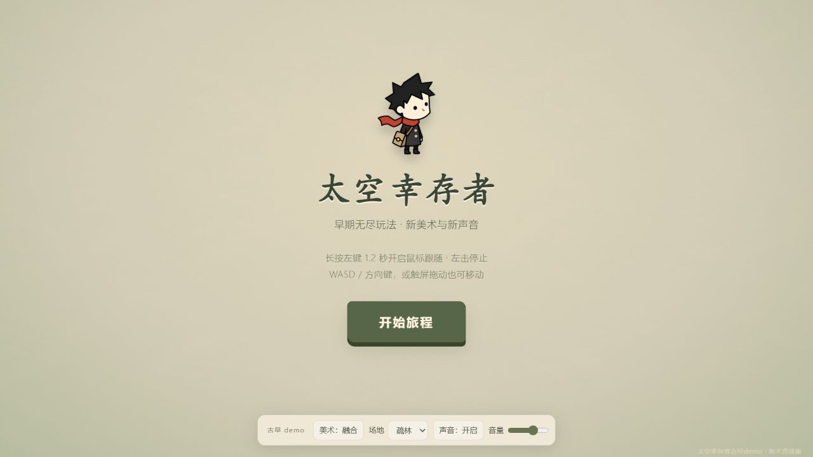
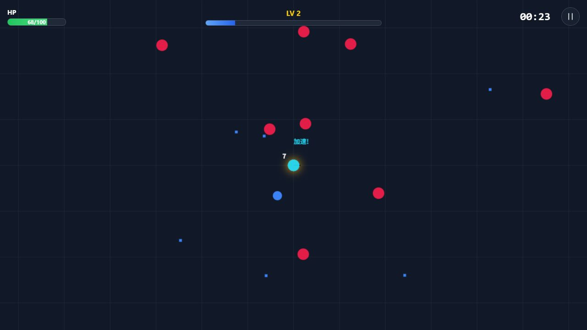
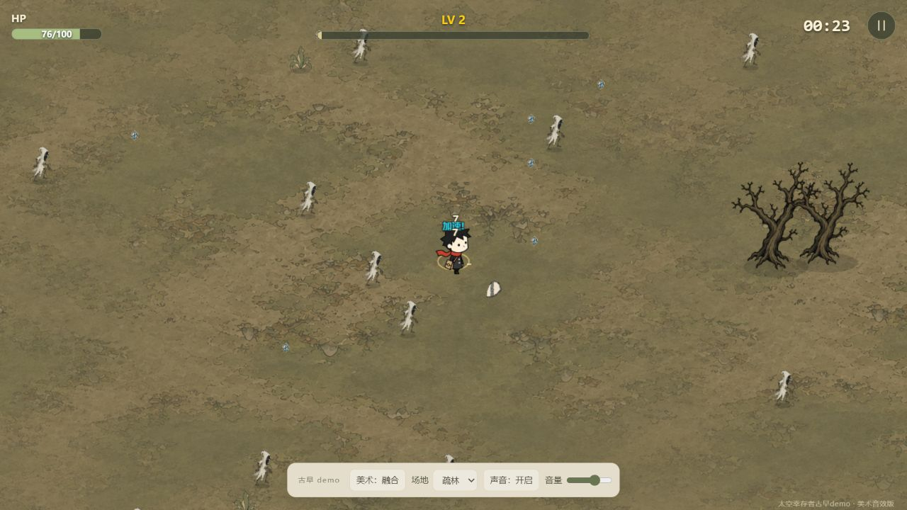
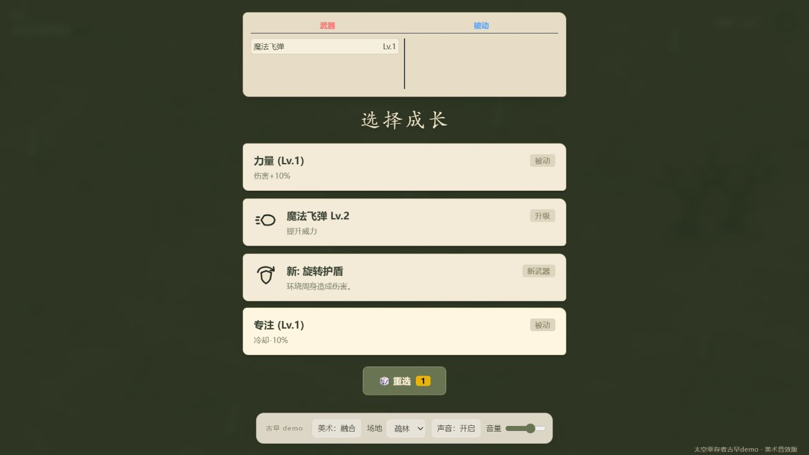

<div align="center">

# 太空幸存者古早demo

**从冷色宇宙，到手绘旷野。**

自动出击 · 选择成长 · 在敌群中再多活一会儿

[画面一览](#两种风格同一份生存乐趣) · [玩法](#每次升级都是一次选择) · [开始试玩](#快速开始) · [操作](#操作指南) · [许可](#许可与致谢)



<sub>浏览器小游戏 / 两个独立版本 / 无需构建</sub>

</div>

这是一个保留着早期原型气质的无尽生存小游戏：角色自动攻击，你负责移动、躲避、拾取经验，并在升级时决定下一步成长方向。敌群逐渐逼近，武器不断变强，目标很简单——让这一局再长一点。

仓库包含两种可以独立运行的版本。你可以从几何图形构成的太空版开始，也可以直接走进带有角色美术与合成音乐的旷野。

## 两种风格，同一份生存乐趣

<table>
  <tr>
    <th width="50%">太空版 · Space</th>
    <th width="50%">美术音效版 · Remix</th>
  </tr>
  <tr>
    <td></td>
    <td></td>
  </tr>
  <tr>
    <td><b>冷色、简洁、直接。</b><br>深色网格与几何角色保留早期玩法的样子，专注移动、躲避与成长。这个版本没有音效。</td>
    <td><b>纸感、角色与声音。</b><br>加入角色、敌人、拾取物美术，两种场地，以及实时合成的背景音乐和战斗音效。</td>
  </tr>
  <tr>
    <td>入口文件：<a href="space/index.html">space/index.html</a></td>
    <td>入口文件：<a href="remix/index.html">remix/index.html</a></td>
  </tr>
</table>

美术音效版还支持在同一局中切换几何外观与融合外观，以及「疏林 / 旧道」场地。外观切换不会重开这一局，声音也可以独立关闭。

## 每次升级，都是一次选择

**移动 → 自动攻击 → 拾取经验 → 选择成长 → 迎接更密集的敌群。**

| 可以体验什么 | 这一局里会发生什么 |
| --- | --- |
| 五类武器 | 魔法飞弹、定时炸弹、旋转护盾、大蒜光环与断后圣枪，各有不同的攻击方式。 |
| 成长与进化 | 升级时选择武器或被动能力；满足条件后，武器可以进化。 |
| 不断加压的战斗 | 普通敌群、精英、Boss 与虫群事件，让生存越来越紧张。 |
| 拾取与补给 | 经验推动成长，爱心恢复生命，磁铁帮助收集散落物。 |
| 会发声的战场 | 美术音效版的射击、命中、拾取与升级都有声音反馈；暂停选成长时，音乐仍会继续。 |

<p align="center">
  
  <br><sub>停下来选一次成长，再回到敌群中。</sub>
</p>

## 快速开始

需要 **Python 3** 和支持 Canvas / Web Audio 的现代浏览器。也可以使用你熟悉的静态文件服务器。

**1. 下载代码**

点击仓库右上方 **Code → Download ZIP** 并解压，或运行：

```sh
git clone https://github.com/namgnal/space-survivor-retro-demo.git
cd space-survivor-retro-demo
```

**2. 在仓库目录启动本地服务**

```sh
python -m http.server 8000 --bind 127.0.0.1
```

如果系统的命令是 `python3`，将上述 `python` 换成 `python3` 即可。

**3. 在浏览器中选择版本**

打开 **<http://127.0.0.1:8000/>**。也可以直接进入 [太空版](http://127.0.0.1:8000/space/) 或 [美术音效版](http://127.0.0.1:8000/remix/)。这些是本地地址，需要先启动上面的服务。

游戏所需资源均在仓库内，不需要安装前端依赖、构建或登录账号。由于使用 JavaScript 模块，请通过 HTTP 服务打开，不要直接双击 HTML 文件。结束服务时，在终端按 `Ctrl + C`。

## 操作指南

| 操作 | 太空版 | 美术音效版 |
| --- | --- | --- |
| 鼠标移动 | 按住鼠标拖动 | 按住左键，向鼠标方向移动 |
| 持续跟随 | — | 长按左键 1.2 秒后松手；再左击停止 |
| 键盘移动 | — | `W A S D` 或方向键 |
| 触屏移动 | 拖动屏幕 | 拖动屏幕，松手停止 |
| 暂停 / 继续 | 右上角暂停按钮 | 右上角按钮或 `Esc` |
| 成长选择 | 点击选项 | 点击选项或按 `1`–`4` |
| 外观与声音 | — | 底栏切换外观、场地、声音和音量 |

> 美术音效版的鼠标跟随会在暂停、成长选择后保留；使用键盘接管、移出窗口或切到后台时会取消。声音会在点击开始后启动。

## 关于这个 demo

它是一份可直接运行和阅读源码的早期小游戏，适合短局试玩、比较两种表现风格，也适合研究 Canvas 游戏与 Web Audio 合成声音。

- **无尽生存**：目标是尽量生存更久。
- **每局重新开始**：刷新页面会重开，不保存进度。
- **本地运行**：没有账号系统、外部服务接口或数据上传功能。
- **原型范围**：尚未进行完整的平衡和长时间性能验证。

<details>
<summary>查看目录结构</summary>

```text
index.html          版本选择入口
space/              太空版
remix/              美术音效版
  assets/           角色、场地、特效与图标
  vendor/           音频、鼠标控制和样式
docs/images/        README 实机截图
```

</details>

## 许可与致谢

**代码采用 MIT，美术素材保留权利。** 两者的授权范围不同：

- [代码许可证](LICENSE)：允许在保留许可证与署名的前提下使用、修改和分发代码。
- [美术素材许可](remix/assets/LICENSE.md)：`remix/assets/` 中的 PNG、SVG 不适用 MIT，仅供随本仓库运行、体验此 demo；其他使用须获得授权。
- [截图说明](docs/images/LICENSE.md)：README 中的游戏截图同样不提供其中美术素材的复用授权。
- [第三方致谢与许可](THIRD_PARTY_NOTICES.md)：保留游戏基础代码和 Tailwind CSS 的来源署名。

---

<p align="center"><sub>选一种风格，开始下一局。</sub></p>
